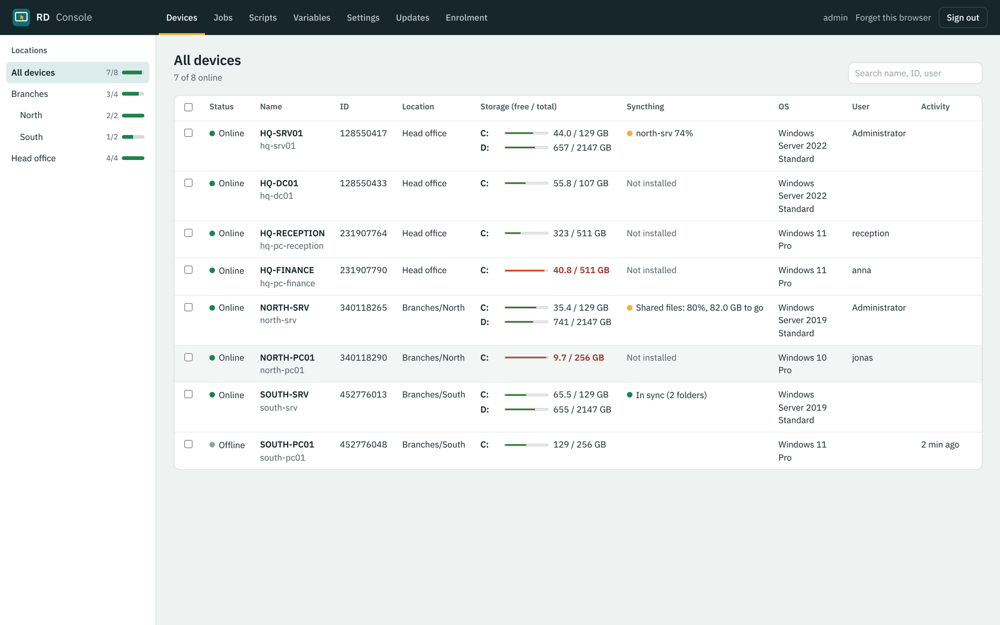
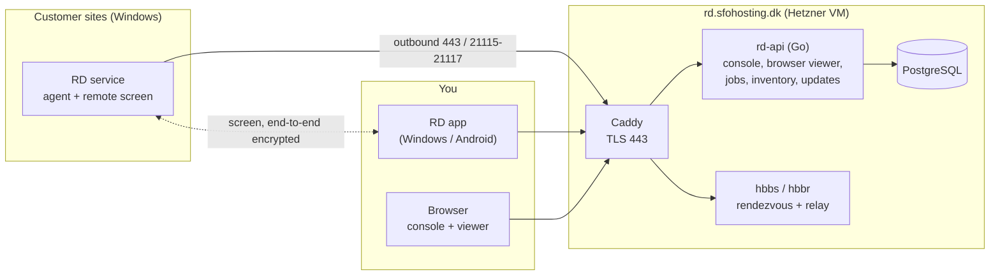

# RD: self-hosted remote control

RD is a TeamViewer/AnyDesk-style remote control platform for your own Windows
servers and PCs. It runs on one small server you control, and is built on a
fork of [RustDesk](https://github.com/rustdesk/rustdesk).



## What it does

| Area | Features |
| --- | --- |
| **Remote control** | Unattended access to every enrolled device without a password prompt. The Windows app has screens, Ctrl+Alt+Del, scale and quality, file transfer and the Windows session picker. There is a browser viewer with clipboard, and an Android viewer. |
| **Console** (web) | Devices by location with online state, storage and Syncthing status. Device details, inventory and installed programs. Restart, shut down and run scripts. Account-wide device settings. Sign in with password and authenticator, and remember a browser for 30 days. |
| **Scripts** | A saved script library in PowerShell or cmd. Variables per server (IP, host name, share), set on a device or a location. JSON import and export, schedules, and a run log per script and per device. |
| **Fleet** | Inventory every 6 hours, client updates rolled out from the console, and a one-line PowerShell installer. Alerts to your phone via ntfy: logins, devices offline, low disk, failed jobs, Syncthing out of sync. |
| **Network** | Clients connect out only. TCP 443 is enough at sites with strict firewalls (WebSocket). |

## How it fits together



- The **RD service** on each device registers with hbbs, sends a heartbeat,
  inventory and Syncthing status, and runs jobs signed by the server.
- The **API server** (`server/`) holds devices, locations, scripts, jobs,
  schedules and releases. It also serves the console and the browser viewer.
- **hbbs/hbbr** (`rendezvous/`, our fork with server-side key exchange and
  WebSocket registration) connect viewers to devices, either directly or
  through the relay.

## Documentation

| For | Read |
| --- | --- |
| Using RD day to day: the app, the browser viewer, the console | [User guide](docs/user-guide.md) |
| Scripts, variables, schedules and the run log | [Scripts](docs/scripts.md) |
| Syncthing status and alerts | [Syncthing](docs/syncthing.md) |
| Installing RD on a Windows machine | [Installing on Windows](docs/install-windows.md) |
| Android viewer | [Android](docs/android.md) |
| Everything you do on the server | [Runbook](docs/runbook.md) |
| Building the server from scratch | [Server setup](docs/server-setup.md) and [firewall test](docs/firewall-test.md) |
| Building the client, what is changed from RustDesk | [Client build](docs/client-build.md) |
| Security model and findings | [Security review](docs/security-review.md) |
| Before giving RD to anyone else | [Release preparation](docs/release.md) |

## Layout

```
client/      RustDesk client 1.5.3, vendored, plus our changes (AGPL-3.0)
patches/     our changes to client/ as one patch (re-applied on upstream updates)
rendezvous/  rustdesk-server fork: hbbs/hbbr with key exchange + WebSocket (AGPL-3.0)
server/      API server (Go): console, browser viewer, jobs, fleet; SQL migrations
web/         browser viewer source (TypeScript), built into server/
installer/   Windows silent-install script
deploy/      docker-compose, Caddyfile, setup, backup and restore scripts
scripts/     maintenance scripts (patch refresh, clear saved passwords)
docs/        guides; images in docs/images
.github/     CI: server tests, Windows and Android builds, security scans
```

## Licence

`client/` and `rendezvous/` are RustDesk, licensed AGPL-3.0; their notices
are kept intact. If the client is ever distributed outside your organisation,
its source (including `patches/`) must be published under AGPL-3.0.
Code outside them is © the repository owner, all rights reserved, until a
licence is chosen (see [Release preparation](docs/release.md)).
