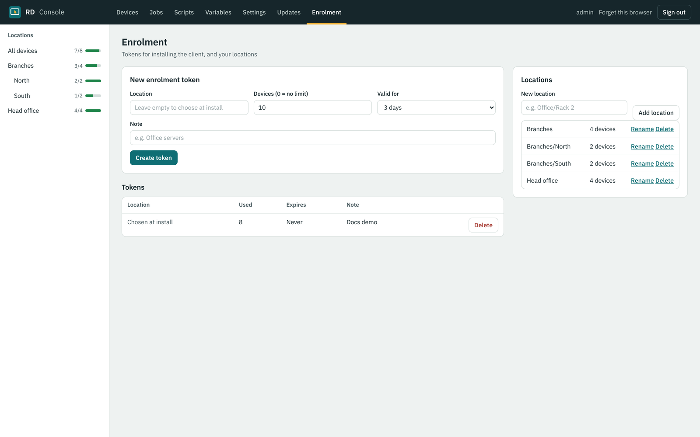

# Installing on Windows

Works on 64-bit Windows 10/11 and Windows Server (tested on Server 2022).

## 1. Create an enrolment token

Console → **Enrolment** → **New enrolment token**. Pick the location (or
leave it empty to choose one per install), how many devices it may enrol, and
how long it is valid.



## 2. Install with one line

On the machine, open PowerShell **as Administrator** and run:

```powershell
irm "https://rd.sfohosting.dk/install?token=<token>" | iex
```

To choose the location or force WebSocket (sites where only outbound 443 is
open):

```powershell
& ([scriptblock]::Create((irm https://rd.sfohosting.dk/install))) -Token <token> -Group "Branches/North" -WebSocket
```

The installer:

1. downloads the client build that is rolled out in the console (or the newest
   uploaded one), and checks its SHA-256;
2. installs RD to `C:\Program Files\RD` as a service that starts at boot,
   before anyone signs in, with no tray icon and no prompt on screen;
3. sets a random unattended password that is never shown or stored anywhere.
   The device reports only a hash of it;
4. enrols the device in the token's location and restarts the service, so the
   device shows online in the console within a minute.

Log: `C:\ProgramData\RD\install.log`.

### Offline or from a share

Download `rd-windows-x64` from the green **Windows client** run in GitHub
Actions, unzip it, and run as Administrator (or as SYSTEM from Gizmo, GPO or
Intune):

```powershell
powershell -ExecutionPolicy Bypass -File install.ps1 -Token <token> -Group "Branches/North"
```

`test-connection.ps1` in the same folder checks DNS, the ports, TLS and the
API, and says whether the site needs `-WebSocket`.

## Connecting

See the [User guide](user-guide.md): sign in to the RD app or the browser
viewer and double-click the device. You get no password prompt.

## Reinstalling

Run the installer again with a valid token. A reinstall gives the device a
new unattended password, and the server replaces the old one.

On your own PC, builds up to 28 of the RD app may then say **"Wrong
password"** for that device, because they try the password they saved last
time. Clear it with `scripts/clear-saved-password.ps1 -Id <device ID>` (see
the [User guide](user-guide.md#wrong-password-after-a-device-was-reinstalled)).
Later builds use the server's password first.

## Updating

Installed devices update themselves when you roll out a build in the console
(**Updates**). You do not need to run the installer again.

## Moving or removing

- Move to another location: console → device → **Move**.
- Remove: console → device → **Remove device**, then on the machine:

```powershell
& "C:\Program Files\RD\RD.exe" --uninstall
```
