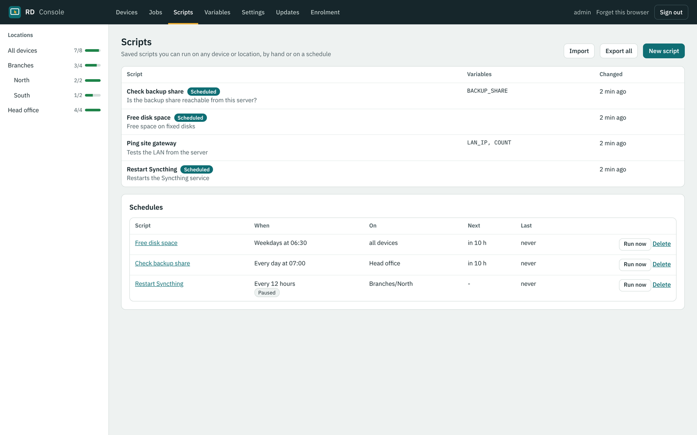
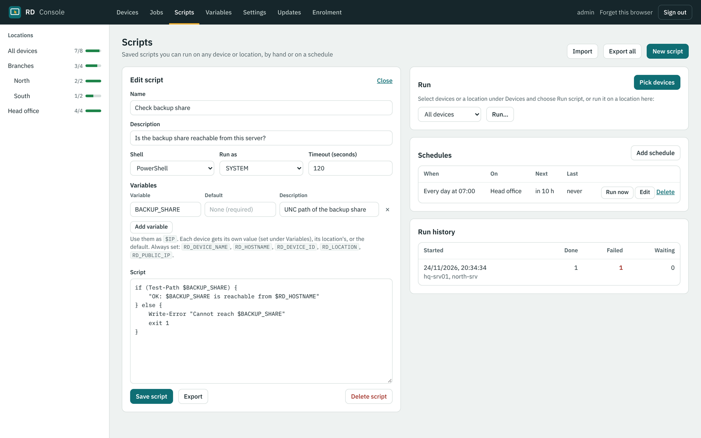
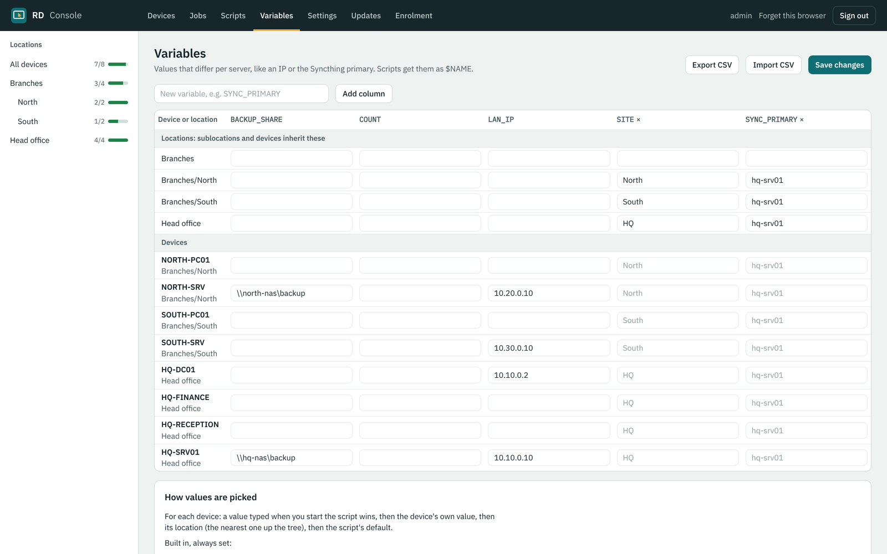
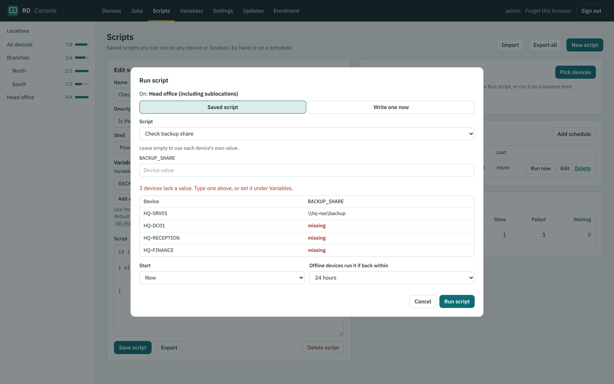
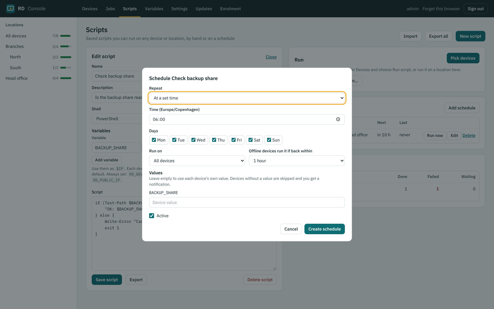

# Scripts, variables and schedules

The console can run PowerShell or command-prompt (cmd) scripts on any device,
location or the whole fleet. Scripts run as SYSTEM through the RD service.
Every run is logged with its exit code, output and the values it used.

## Script library

**Scripts** in the console lists your saved scripts and every schedule.



- **New script** opens the editor.
- **Import** loads scripts from an export file. **Export all** saves every
  script to one JSON file.
- A **Scheduled** tag marks scripts that have a schedule.

### Editing a script



| Field | Notes |
| --- | --- |
| **Name**, **Description** | Shown in the library, in the run dialog and in the job log |
| **Shell** | PowerShell (Windows PowerShell 5.1) or Command prompt |
| **Run as** | SYSTEM. ("Logged-on user" is listed but not supported by the client yet: such runs fail with a message.) |
| **Timeout** | The run is stopped and marked failed after this many seconds |
| **Variables** | Values that differ per server: see below |
| **Script** | The body. Tab indents, and Shift+Tab leaves the editor. |

A script **succeeds** when it exits with code 0. Any other exit code, or a
timeout, marks the run **failed** and sends a failed-job alert. In PowerShell,
end with `exit 1` when something is wrong so the log shows it.

On the right of a saved script:

- **Run:** pick a location (or **Pick devices** under Devices) and start it.
- **Schedules:** add, edit, pause, **Run now** or delete schedules for this
  script.
- **Run history:** every run of this script, with how many devices succeeded,
  failed or are still waiting. Click one to see the output per device.

## Variables

Variables let one script work on every server when something differs per
server, such as an IP address, a host name or a share path.

### 1. Declare them in the script

Under **Variables** in the editor, add a row per variable:

- **Variable:** the name, using letters, digits and `_`, for example `LAN_IP`.
- **Default:** used when neither the device nor its location has a value.
  Leave it empty to make the variable required.
- **Description:** what it is, shown as a hint when running.

Use them in the script as `$LAN_IP` in PowerShell, or `%LAN_IP%` in cmd.

### 2. Give each server its values

**Variables** in the console is a grid of every location and device.



- A value on a **location** applies to every device in it and in its
  sublocations, for example `SYNC_PRIMARY = hq-srv01` on a whole branch.
- A value on a **device** overrides its location.
- Empty cells show the inherited value in grey.
- **Add column** adds a variable. **Save changes** saves every row you
  changed; changed cells are highlighted until then.
- **Export CSV** / **Import CSV** let you fill the grid in Excel. The file
  uses `;` (Excel with Danish settings opens it in columns), and import also
  accepts `,`. Columns are `kind;id;name;VAR1;VAR2...`. Rows are matched by ID,
  or by name (display or computer name) when the ID is empty. An empty cell
  clears that value.

You can also edit one device's values on its page (**Variables → Edit**).

### 3. How a value is picked

For each device, the first of these that has a value wins:

1. A value typed in the run dialog (or stored on the schedule)
2. The device's own value
3. Its location's value, the nearest one up the tree
4. The script's default

Always set, and cannot be overridden:

| Variable | Value |
| --- | --- |
| `RD_DEVICE_ID` | RD ID |
| `RD_DEVICE_NAME` | Display name, or the computer name |
| `RD_HOSTNAME` | Computer name |
| `RD_LOCATION` | Location path, such as `Branches/North` |
| `RD_PUBLIC_IP` | Public IP of the last heartbeat |

Inline scripts ("Write one now") get every variable the device has too.

### Running with variables



The run dialog shows the value each device will get. A device without a value
for a required variable is shown as **missing**, and the run is refused until
you either type a value in the dialog (used for every device) or set one under
Variables.

### How the values reach the script

The server writes the values in front of the script body when the device
fetches the job:

```powershell
$LAN_IP = '10.20.0.10'
$RD_HOSTNAME = 'north-srv'
# ...your script follows
```

```bat
@set "LAN_IP=10.20.0.10"
@set "RD_HOSTNAME=north-srv"
rem ...your script follows
```

Values are quoted, so quotes, `%` and `&` in a value are safe. Values must be
one line. The lines are part of the signed job, so the device runs exactly
what the server sent. The values each run got are stored with the run and
shown in the job log.

**Limits:**

- Names that PowerShell reserves (`HOST`, `PID`, `HOME`, `ERROR` and similar)
  are refused. Use `HOSTNAME`, `SERVER` and so on.
- Names starting with `RD_` are built in.
- A `param()` block at the top of a script does not work, because the lines
  are put in front of it.

## Schedules

**Add schedule** on a script:



| Option | Notes |
| --- | --- |
| **Repeat** | **At a set time** on chosen weekdays, or **Every few hours** (1–168) |
| **Time** | In the time zone of the browser that created the schedule (Europe/Copenhagen) |
| **Run on** | All devices, or a location (with sublocations). Devices added later are included automatically. |
| **Offline devices run it if back within** | 1–24 hours |
| **Values** | Optional values for every device, like the run dialog |
| **Active** | Untick to pause without deleting |

Each run is an ordinary job tagged **Scheduled**, so it appears under Jobs,
in the script's run history and in each device's script history. Devices
without a value for a required variable are skipped, and you get an alert
naming them. **Run now** starts the schedule once without changing its timing.

## Import and export

- **Export all** (library) or **Export** (one script) downloads
  `rd-scripts-<date>.json` with name, description, shell, timeout, variables
  and body.
- **Import** reads such a file. Scripts whose name already exists are skipped,
  unless you tick **Replace scripts that have the same name**.
- Schedules and device values are not part of the file. Device values go
  through the Variables CSV.

## Run log

| Where | Shows |
| --- | --- |
| **Jobs** | Every job: target, done / failed / waiting |
| **Job page** | Per device: result, exit code, variables used, output (up to 256 KB) |
| **Script → Run history** | The last 25 runs of that script |
| **Device → Script history** | The last 50 jobs on that device, with output |

Jobs and their output are kept in the database (and in the nightly backup).

## Example: check a backup share on every server

1. New script **Check backup share**, PowerShell, variable `BACKUP_SHARE`
   with no default:

   ```powershell
   if (Test-Path $BACKUP_SHARE) {
       "OK: $BACKUP_SHARE is reachable from $RD_HOSTNAME"
   } else {
       Write-Error "Cannot reach $BACKUP_SHARE"
       exit 1
   }
   ```

2. Under **Variables**, set `BACKUP_SHARE` on each server (or import a CSV).
3. **Add schedule:** every day at 07:00 on the servers' location.
4. A failure sends an alert. The output is under Jobs and on the device.
