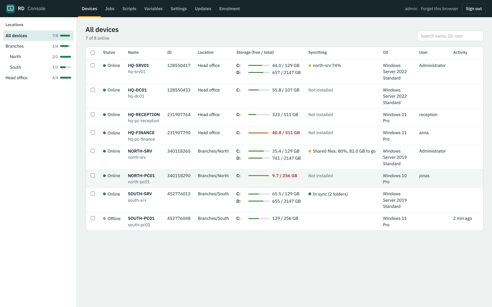
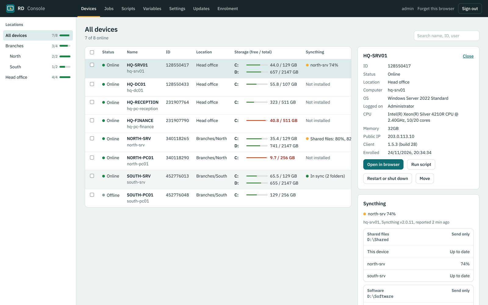

# Syncthing status

Most servers run Syncthing, which syncs folders from one primary server to
the others. RD reads each server's local Syncthing and shows in the console
whether everything is in sync.

## What you see

**Devices → Syncthing column** (shown once any device reports):

| Status | Meaning |
| --- | --- |
| 🟢 **In sync (2 folders)** | Every folder on this device is up to date, and every connected remote device has 100% |
| 🟡 **north-srv 74%** | A remote device has not received everything yet (seen from the primary) |
| 🟡 **Shared files: 80%, 82.0 GB to go** | This device is still receiving a folder |
| 🟡 **vaenget-srv is not connected** | A device that shares a folder is offline in Syncthing |
| 🟡 **Folder X is paused** | A folder is paused on this device |
| 🔴 **Folder X: 3 item(s) failed to sync** | Syncthing reports errors for the folder |
| 🔴 **Syncthing not reachable** | Syncthing runs, but RD could not ask it (API key or address) |
| ◯ **No report since …** | No report for 20 minutes: the device is offline or on an old build |
| **Not installed** | No Syncthing on this device |

When there is more than one problem, the worst comes first, followed by
"(+N more)". Hover over the status to see them all.

**Device page → Syncthing** shows each folder (name, path, send-only or
receive-only), this device's state, and how far each remote device has come.

## Alerts

When a device stays out of sync for `ALERT_SYNC_MINUTES` (default 240), the
server sends an ntfy alert ("RD: out of sync"). It sends another when the
device is back in sync. Set it in `/opt/rd/deploy/.env`, where 0 turns it off,
then restart the API (see [Runbook](runbook.md#alerts)).

## How it works

- From client build 28 on, the RD service runs `syncthing.ps1`
  (`client/src/rd/syncthing.ps1`) 90 seconds after it starts, then every
  5 minutes.
- The script finds Syncthing's `config.xml`. It looks in the folder given on
  the command line of a running `syncthing.exe` (`--home`/`--config`), then in
  the usual places: `C:\Users\*\AppData\Local\Syncthing`,
  `C:\ProgramData\Syncthing`, the SYSTEM and LocalService profiles, and
  SyncTrayzor.
- It reads the GUI address and API key from the config and asks the local
  REST API (`/rest/db/status`, `/rest/db/completion`,
  `/rest/system/connections`) on 127.0.0.1 only.
- The report is signed with the device's key and posted to the server. The
  server keeps the newest report per device.

Nothing is changed in Syncthing. RD only reads.

## When it says "not reachable"

- Syncthing's GUI must listen on the machine itself (default
  `127.0.0.1:8384`). An address like `0.0.0.0:8384` also works, but a Unix
  socket does not.
- A custom config folder must be on the command line (`--home`) or in one of
  the places above.
- To test on the server, run the same script by hand as SYSTEM, for example
  as a console script with the body of `syncthing.ps1`. The output is the
  report, or the error.
