# User guide

How to use RD day to day. There are three ways in:

| | Use it for |
| --- | --- |
| **RD app** (Windows) | Everyday remote control: full keyboard, files, several sessions in tabs |
| **Browser viewer** (`https://rd.sfohosting.dk/web/`) | Quick access from any PC without installing anything |
| **Console** (`https://rd.sfohosting.dk`) | Managing the fleet: devices, scripts, schedules, updates, settings |

All three use the same account: username, password and authenticator code.

---

## The RD app

### Sign in

Start `RD.exe` and sign in with your username and password. You then enter
the 6-digit code from your authenticator app. The app keeps you signed in
until you choose **Sign out** under the account menu or in Settings.

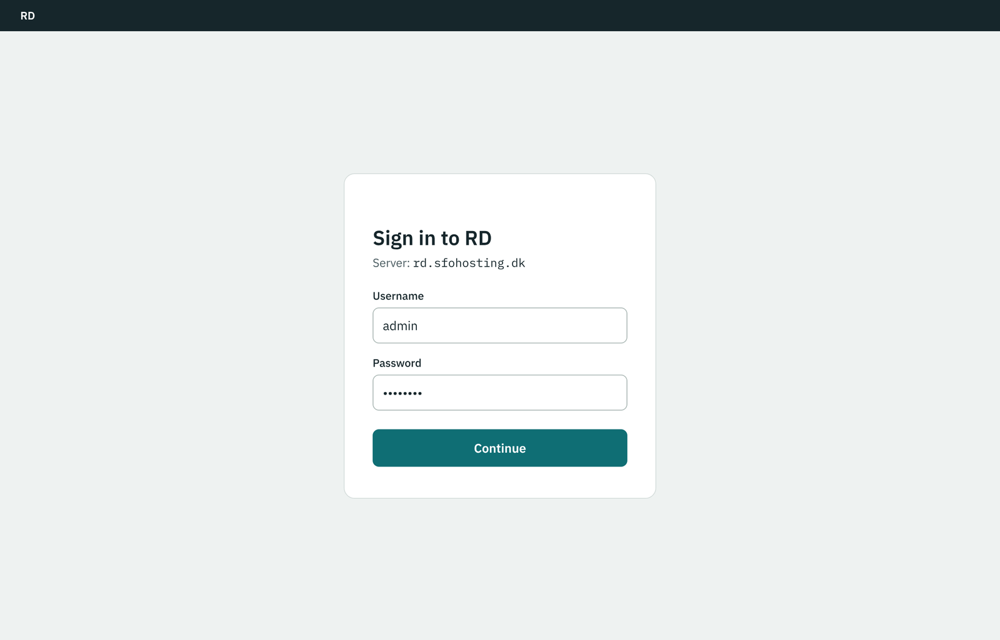

### Find a device

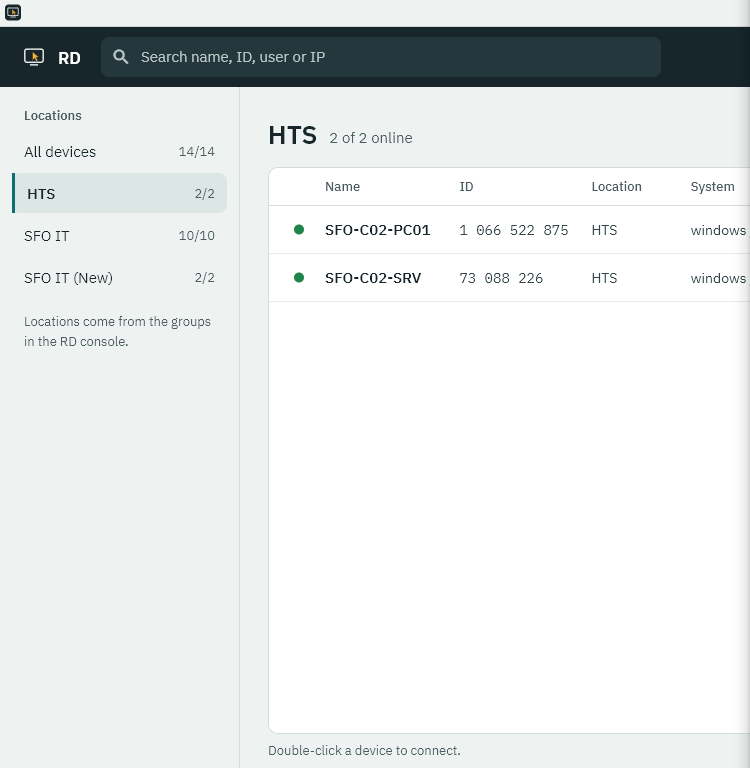

- **Locations** on the left come from the console. **All devices** shows
  everything, and the counts show online/total.
- **Search** finds a device by name, ID, logged-on user or IP.
- A filled green dot means online. A hollow ring means offline.
- Select a device to see its details. Double-click it, or click **Connect**,
  to open a session.

There is no password prompt. The app uses the unattended access the device
reported to the server.

### In a session

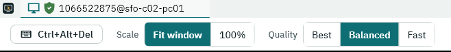

| Control | What it does |
| --- | --- |
| **Screen 1 / 2** | Switch monitor (shown when the device has more than one) |
| **Ctrl+Alt+Del** | Sends the secure attention sequence, for example to unlock a server |
| **Scale** | **Fit window** shrinks the screen to the window. **100%** shows real pixels and you scroll. |
| **Quality** | **Best**, **Balanced** (default) or **Fast** for slow links |
| **More** | Transfer files, run a script on this device, lock the screen, reboot |
| **Disconnect** | Ends the session |

Each session opens in a tab, so you can work on several devices side by side.
Clipboard text is synced both ways while a session is open.

When a server has more than one person signed in (console plus Remote
Desktop), RD asks which session to show.

### Settings

**Settings** (account menu) sets the scale and quality every new session starts
with, and shows your account, the server and this PC's ID.

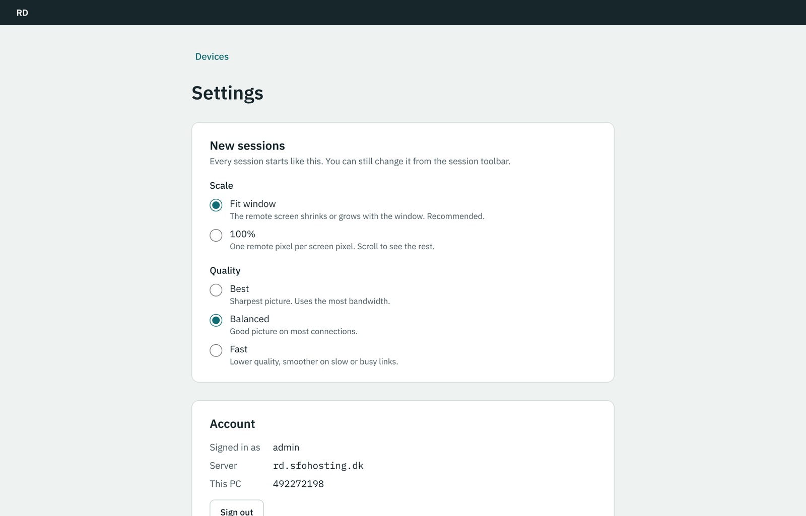

### "Wrong password" after a device was reinstalled

A reinstall gives the device a new random unattended password. Builds up to
28 of the app try the password saved from your last connection first, so they
say "Wrong password". The browser viewer still works.

To fix it, clear the saved password on **your** PC, then connect again:

```powershell
powershell -ExecutionPolicy Bypass -File "$env:USERPROFILE\Downloads\clear-saved-password.ps1" -Id <device ID>
```

The script is in `scripts/clear-saved-password.ps1`. Leave out `-Id` to clear
the saved passwords of every device. From the build after 28, the app uses the
server's current password first, so this no longer happens.

---

## Browser viewer

Open `https://rd.sfohosting.dk/web/`, sign in, and click a device.

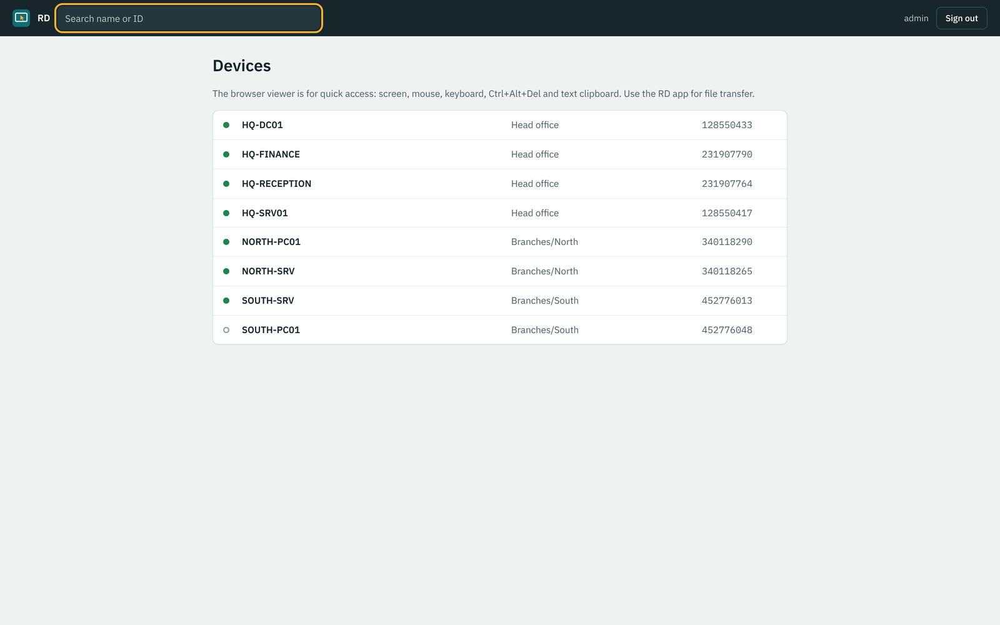

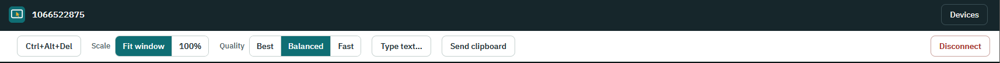

- **Ctrl+Alt+Del**, **Scale** (Fit window / 100%), **Quality**, screen
  switching, and **Type text…** for pasting long text as keystrokes.
- **Clipboard:** text copied on the device lands on your clipboard
  automatically. To send your clipboard to the device, click **Send
  clipboard** once and allow clipboard access when the browser asks. After
  that, your clipboard is sent every time you come back to the tab.
- No file transfer or sound. Use the app for those.

The browser viewer connects through the relay over 443. Use it when the app
is not installed or a firewall blocks everything else.

---

## Console

Open `https://rd.sfohosting.dk`.

### Sign in and remember this browser

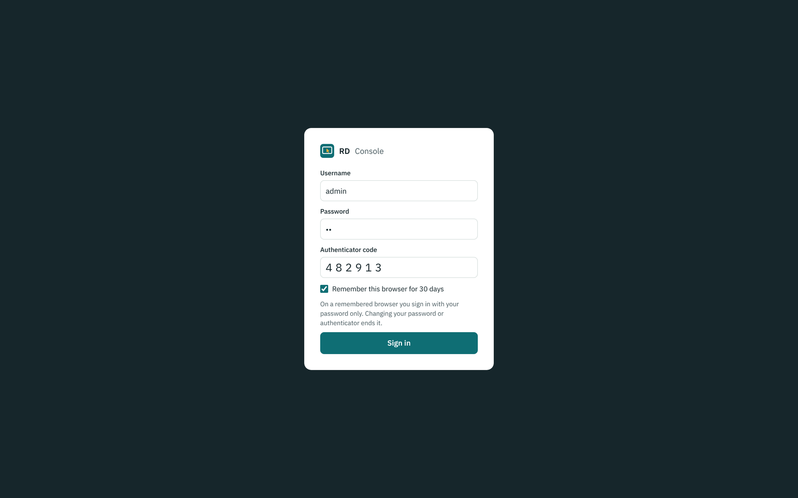

After the password, the console asks for your authenticator code. If you tick
**Remember this browser for 30 days**, this browser only asks for your password
for the next 30 days.

- Changing your password or authenticator ends every remembered browser.
- **Forget this browser** (top bar) ends it for the browser you are using.
- The RD app always asks for the code.

### Devices

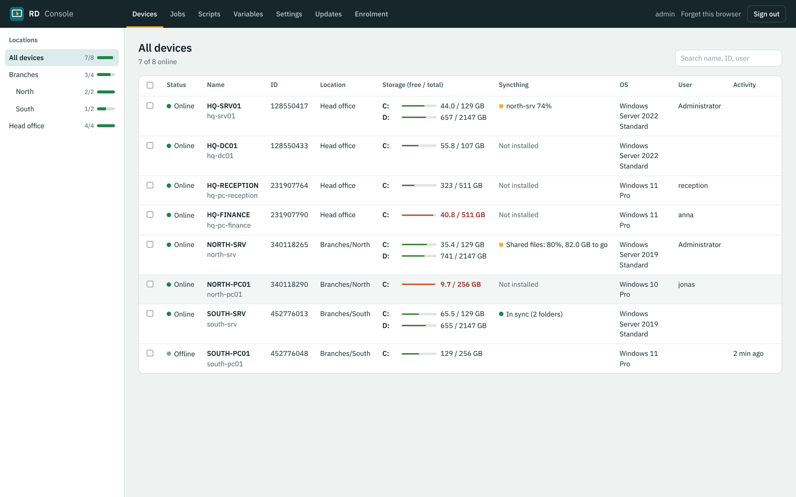

The list shows every device in the selected location (and its sublocations):

- **Status:** online or offline. **Activity** shows when an offline device
  was last seen.
- **Storage:** free and total space for each fixed disk. Red means less than
  10% free.
- **Syncthing:** in sync, how far a server has come, or what is wrong. See
  [Syncthing](syncthing.md). The column appears once a device reports.
- **OS** and logged-on **User**.

Tick devices to **Run script**, **Restart or shut down** or **Move** all of
them at once. With nothing ticked, **Run script on location** runs on
everything in the selected location.

### Device page

Click a device to open its panel.

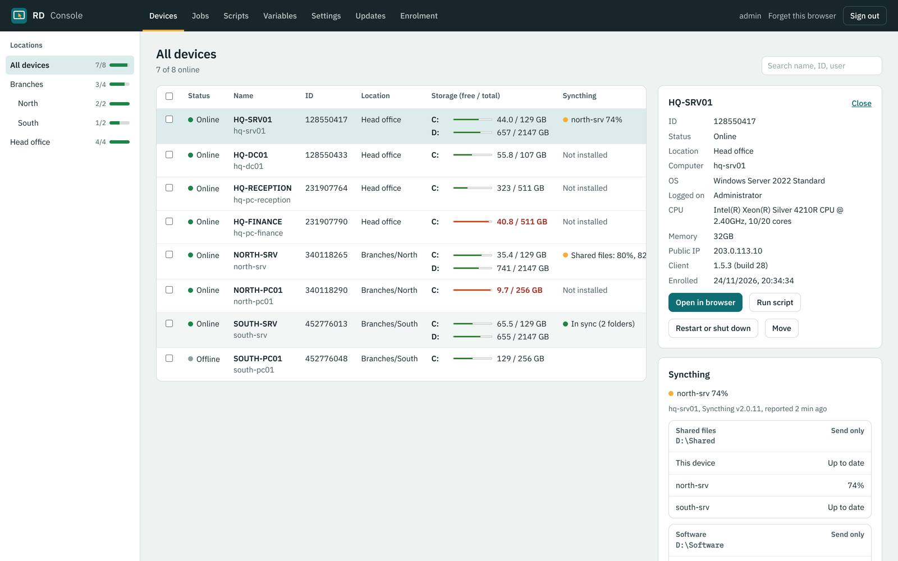

- **Details:** ID, location, computer name, Windows, logged-on user, CPU,
  memory, public IP, client build, enrolled date.
- **Open in browser** starts the browser viewer. **Run script**, **Restart or
  shut down** and **Move** (to another location) act on this device.
- **Syncthing:** every folder and how far each other server has come.
- **Name and note:** a display name (shown everywhere instead of the
  computer name) and a free-text note.

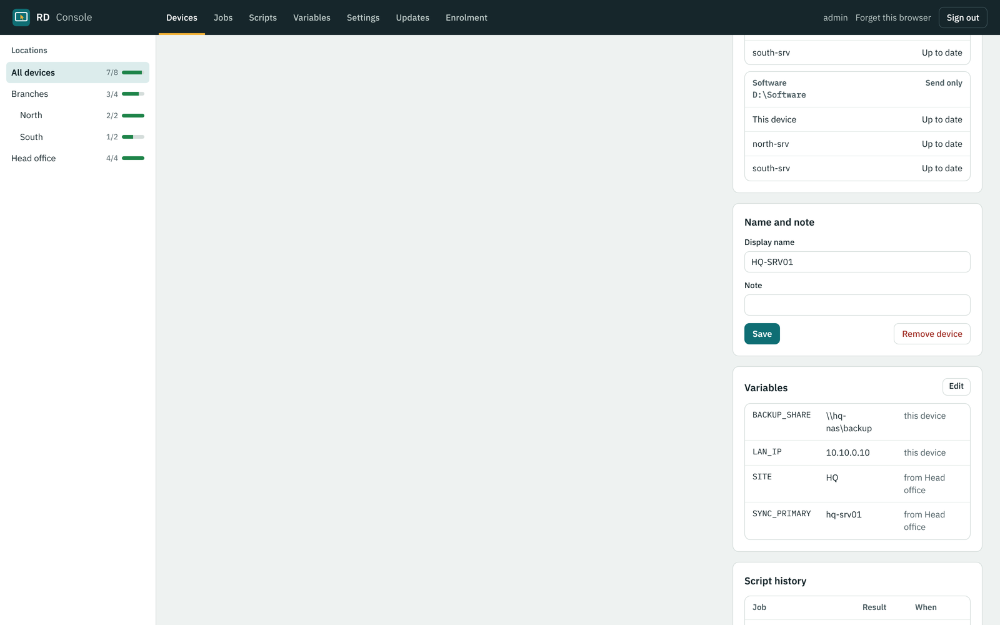

- **Variables:** values scripts get on this device, and where each comes from
  (this device, or a location). **Edit** changes the device's own values.
- **Script history:** every script, power action and update sent to this
  device, with the result, exit code, output and the values it ran with.

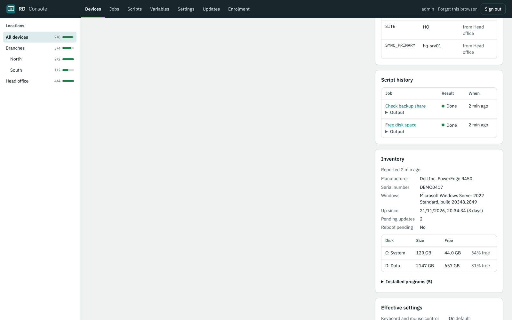

- **Inventory** (every 6 hours): manufacturer, model, serial number, Windows
  build, up since, pending Windows updates, reboot pending, disks, and a
  searchable list of installed programs.

### Jobs

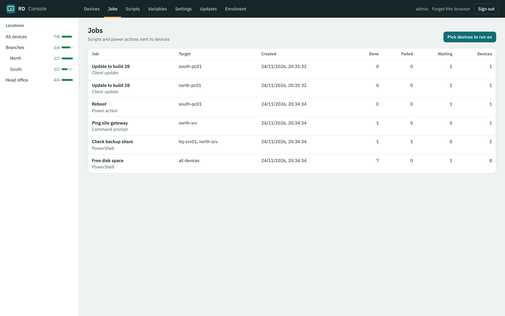

Every script, power action and client update is a job. The list shows the
target and how many devices are done, failed or still waiting. Scheduled runs
carry a **Scheduled** tag.

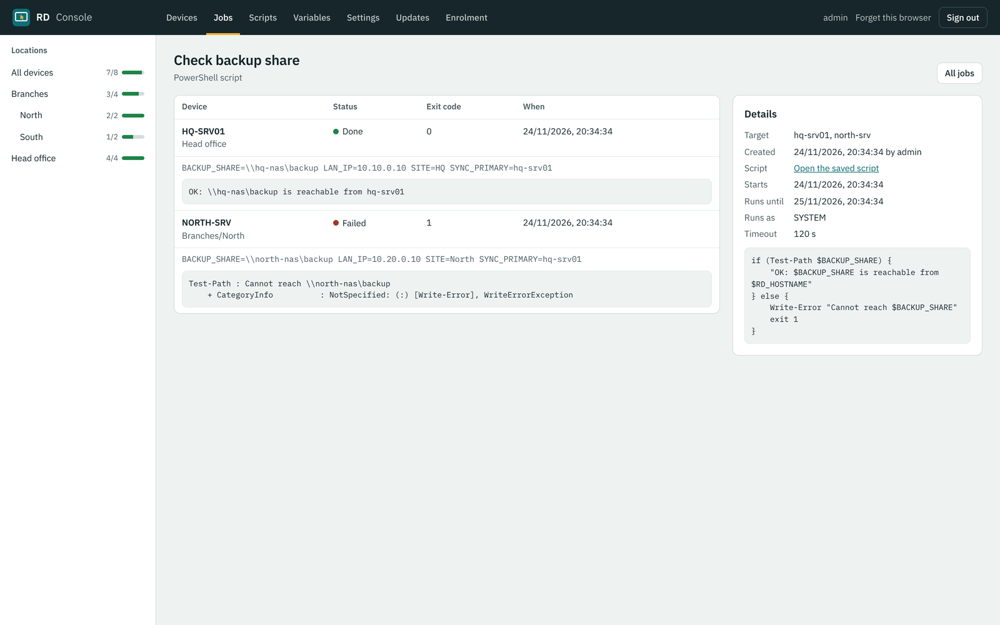

A job shows each device's result, exit code, the variables it got and its
output. Offline devices run the job when they come back, until the job's
deadline. **Cancel waiting devices** stops it for devices that have not
picked it up yet.

### Scripts, variables and schedules

See [Scripts](scripts.md) for the full guide.

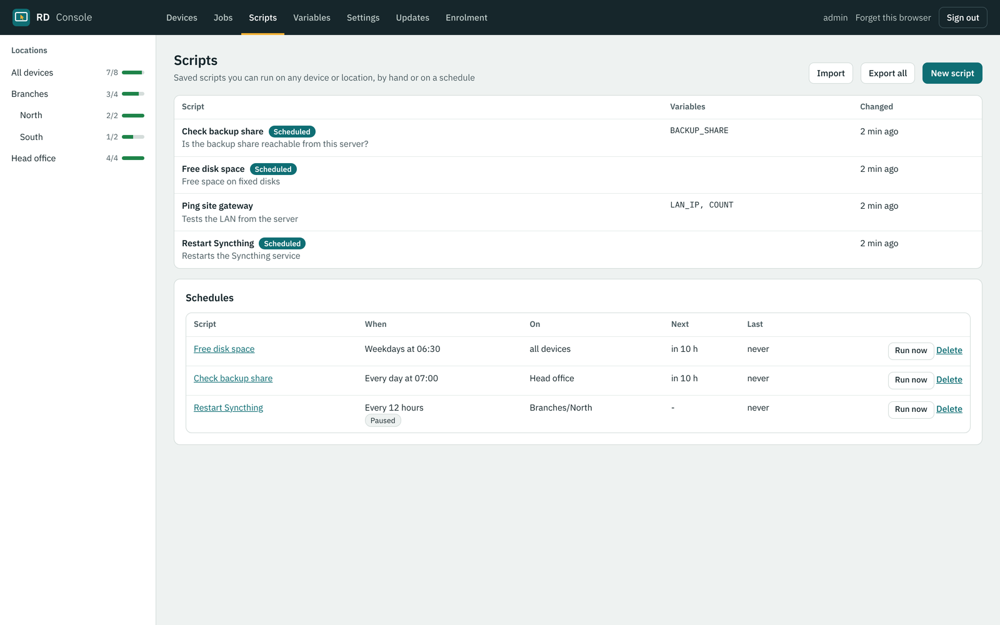

### Settings

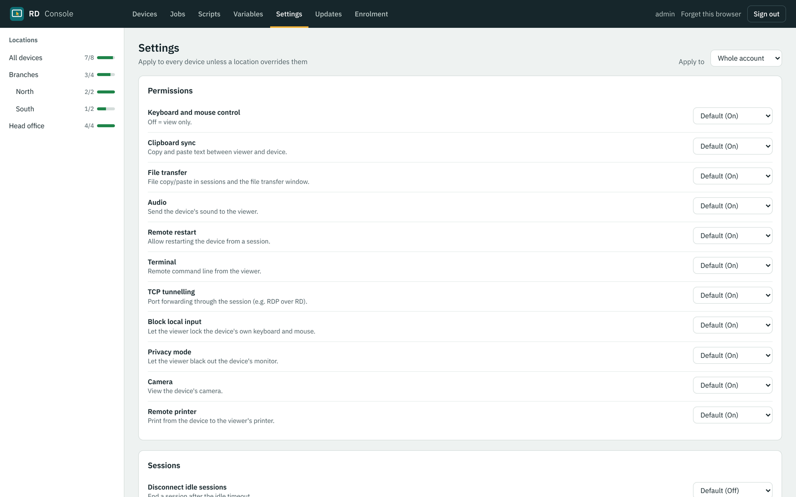

Settings that apply to every device: clipboard, file transfer, audio,
keyboard and mouse, remote restart, terminal, TCP tunnelling, privacy mode,
idle disconnect and more. **Apply to** lets a location override the account
default. Devices pick up changes within about a minute.

### Updates

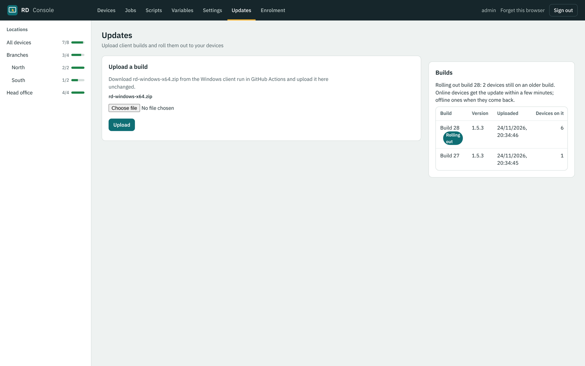

1. Download `rd-windows-x64` from the green **Windows client** run in GitHub
   Actions.
2. **Upload** the zip, then **Roll out** the build.
3. Online devices update within minutes. Their RD service restarts, so open
   sessions drop for about a minute. Offline devices update when they come
   back.

The Builds table shows how many devices run each build. **Stop roll-out**
leaves every device on the build it has.

### Enrolment

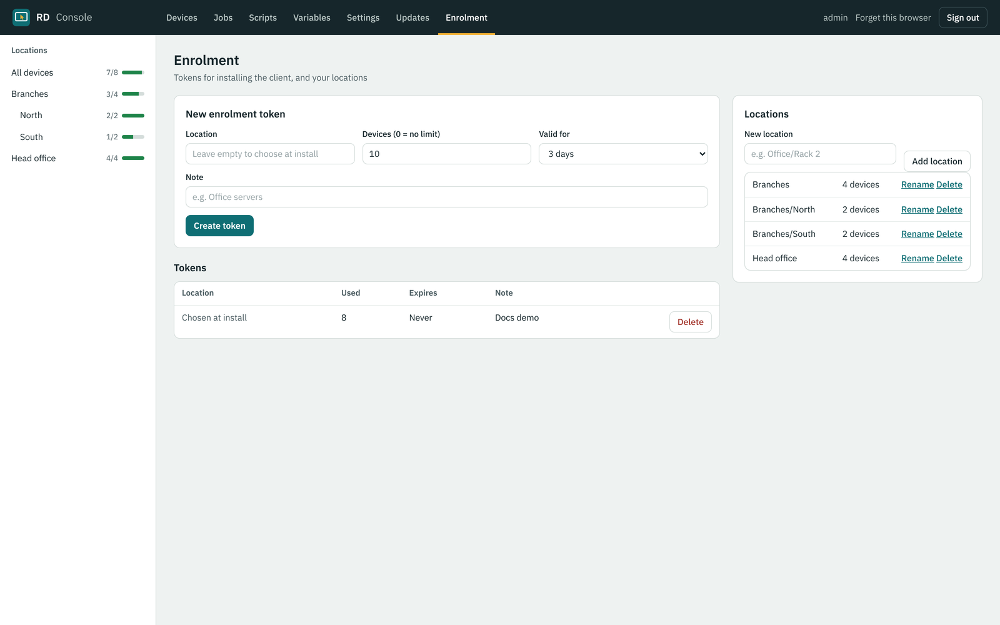

- **New enrolment token:** pick a location (or leave it empty so each install
  chooses), how many devices it may enrol, and how long it is valid.
- **Locations:** create, rename and delete. Use `/` for sublocations, such as
  `Branches/North`.

Install with the token as described in [Installing on Windows](install-windows.md).

---

## Alerts

With `ALERT_NTFY_URL` set on the server, your phone gets a push for:

- every console or app login, and login lockouts
- new enrolments
- a device offline for 10 minutes, and back online
- failed jobs
- a disk with less than 10% free (once a day per disk)
- Syncthing out of sync for 4 hours, and back in sync
- schedules that skipped devices because a variable had no value

The limits are set in `/opt/rd/deploy/.env` (see [Runbook](runbook.md)).
